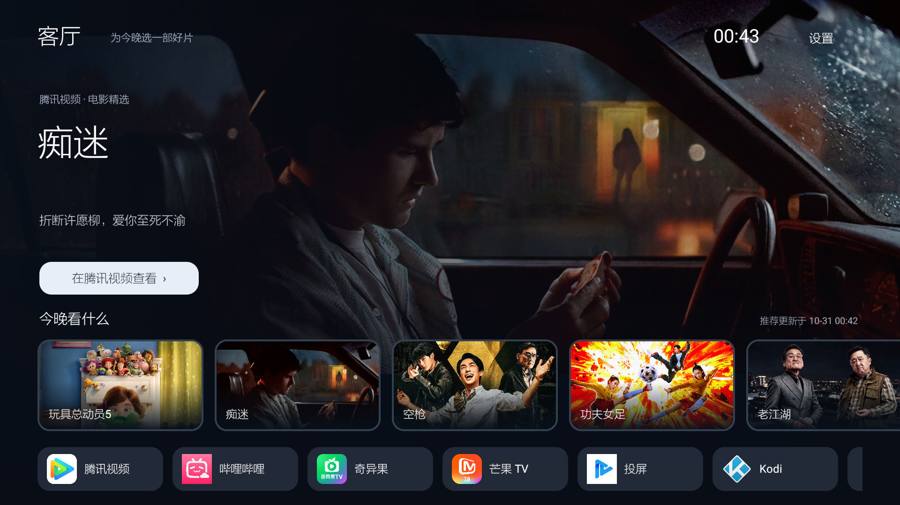

<p align="center"></p>

# 客厅 · LivingRoom

给腾讯极光 A4093 做一个安静、清爽的电视首页：大背景、影视卡片、常用应用，以及遥控器友好的操作。

[下载安装包](https://github.com/VictorAgents/livingroom-launcher/releases/tag/v1.10.1-alpha.1) · [安装与恢复](docs/INSTALL.md) · [Agent Skill](skills/livingroom-install/SKILL.md) · [实现原理](docs/ARCHITECTURE.md) · [验证记录](docs/VALIDATION.md)

**非官方社区预览版，当前为 1.10.1-alpha.1。** 已有实机证据来自一台 A4093；未对第二台原始盒子完整安装验收。不是所有 Android 电视盒通用的刷机包。



*上图为 1.10 基线版真实盒子截图，展示大背景、圆角卡片和应用区。公开社区版保留同一界面与业务代码，去掉预置海报二进制，首次需要联网加载；社区 APK 尚未在设备上安装。截图中的影片、海报及第三方图标用于展示实际界面，相关权利归原权利人。*

## 能做什么

- 最多 10 条腾讯公开电影优先推荐，30 秒切换；遥控器操作后重新计时，离开首页暂停。
- 原图背景与圆角卡片，高清来源可达 1920×800，实际取决于源站。
- 推荐约每 4 小时检查更新，失败保留缓存并约 1 小时后重试。30 秒轮播不等于每 30 秒重新抓取。
- 应用顺序：腾讯视频、哔哩哔哩、奇异果、芒果 TV、投屏、Kodi、全部应用。未安装的应用不显示；无媒体中心入口。
- 在兼容固件上作为默认 HOME；经授权处理腾讯根首页的返回键，保留腾讯语音辅助服务。
- Windows 安装器检查兼容性、保存原设置、安装、回读结果，并提供按设备恢复。
- 可选管理已确认广告入口、推广悬浮窗、屏保与自动熄屏；不保证移除播放器广告。

## 适用范围

| 项目 | 当前基线 |
| --- | --- |
| 盒子 | 腾讯极光 A4093 / SkyworthDigitalRT |
| 系统 | Android 9 / API 28 / armeabi-v7a |
| 默认桌面条件 | 早期白名单含 `com.skyworthdigital.sky2dlauncher`，该包名未被其他应用占用 |
| 电脑安装 | Windows 10/11 x64，PowerShell 5.1 或更新版；电脑与盒子可通过局域网 ADB 互通 |
| USB 安装 | 文件管理器手动打开 APK；不能靠插入 U 盘自动授予系统权限 |

同型号不同固件也要检查。安装器校验型号、API、ABI、白名单、腾讯包与包名占用情况；固件指纹记录在本机备份中，用于恢复时核对身份。它不重写白名单，不 Root、不刷机、不写系统分区、不自动重启。

## 普通用户：电脑安装

1. 下载 Release 中的 `LivingRoom-PC-1.10.1-alpha.1.zip`，完整解压。
2. 让盒子保持亮屏，开启 ADB 调试，记下盒子 IP。第一次连接在电视上允许调试。
3. 双击 `Check.cmd`，准备官方 ADB 并只读检查设备。
4. 双击 `Install.cmd`。准备阶段需联网下载并校验官方 ADB；完整模式还会下载官方 Kodi。输入 IP，核对改动说明，输入 `INSTALL`。
5. 用实体遥控器验证 Home、应用启动及腾讯根首页返回；方便时手动重启确认默认首页。

安装前的设置保存在解压目录的 `backups/`，请保留并另存一份。恢复时运行 `Restore.cmd`，选择同设备备份，输入 `RESTORE`。恢复保留 APK 和 Kodi 数据，不是恢复整个固件。

不需要 Kodi 或设备设置调整时，见[可选命令](docs/INSTALL.md#命令行与-agent)。安装器不会导入 SMB 账号，Kodi 媒体库需另行配置。Kodi、ADB 不打包进本仓库；准备脚本从官方源获取并验证固定校验值。

## U 盘安装

下载 Release 的 `LivingRoom-1.10.1-alpha.1.apk`，复制到 U 盘，在盒子的文件管理器中打开安装。它能打开为普通应用，但开机默认 HOME、辅助服务、使用情况权限与广告设置通常仍需要电脑版配置。插 U 盘不会自动执行安装。

## 让 Agent 帮你安装

把下面这段话交给有本机终端能力的 Agent：

> 请安装 https://github.com/VictorAgents/livingroom-launcher 的 skills/livingroom-install 技能，并按该技能帮我检查和安装客厅。盒子 IP 是我提供的地址；先核对适配条件，说明权限和改动，再按已授权范围操作，保留恢复备份。

Codex 可将仓库中的 `skills/livingroom-install` 文件夹放入其 skills 目录，或用支持 GitHub 路径安装的技能管理工具安装。技能自带固定版本下载助手；先校验 Release 再运行。它不会代替你在电视上首次允许 ADB，也不会擅自开启其他权限。[技能操作说明](skills/livingroom-install/SKILL.md)

## 从源码构建

源码是原生 Android Java，不依赖腾讯 SDK。标准构建需要 JDK 17、Gradle 8.9、Android SDK Platform 28 / Build Tools 34.0.0。工具版本依据 [AGP 8.7 官方兼容表](https://developer.android.com/build/releases/agp-8-7-0-release-notes)。

```shell
gradle :app:assembleDebug
```

或用 Android Studio 打开本目录并选择 Gradle 8.9。未附带 Gradle wrapper；CI 会准备指定版本。Debug APK 使用个人调试签名，**不能覆盖安装官方社区 Release**。发布签名私钥由维护者离线保管，不在仓库或 CI 中。签名不同应停止，不能为“安装成功”自动卸载原应用。

维护者还可用 `scripts/Build-Legacy.ps1` 复用原项目已验证工具链，并显式传入自己的工具和签名路径；详见[构建说明](docs/BUILD.md)。

## 目录

```text
app/                         Android 源码、资源、公开推荐元数据
installer/                   Windows 安装 / 只读检查 / 恢复脚本
skills/livingroom-install/   可安装的 Agent 技能及下载助手
scripts/                     构建、打包和公开内容检查
tests/                       模拟 ADB 安装 / 恢复回归
docs/                        安装、原理、验证、截图
```

## 原理与常见问题

- **是否只是一个 APP？** 是。它以普通 `/data/app` 应用安装，声明 HOME，由系统将它选为默认桌面。
- **怎样进入白名单？** 此固件原有白名单有一个未被占用的候选包名；本项目使用它。不取得厂商签名或 Root，不把应用放进 `/system/priv-app`。见[白名单原理](docs/ARCHITECTURE.md)。
- **推荐是不是最新腾讯首页？** 来自腾讯公开网页的焦点列表与 JSON-LD，不读取电视账号，不保证与电视首页或个性化推荐一致，也不绕过会员或内容权限。
- **为什么需要辅助服务和使用情况访问？** 腾讯原桌面根首页会吞返回键；这两项经授权后只用于识别根页面并返回客厅。不读取屏幕内容、不保存或上传使用历史。普通 Android 日志可能包含调试页面名，不要直接公开日志。
- **断开 ADB 是关机吗？** 不一定；检查盒子画面、调试开关和网络。工具不会主动重启或关机。
- **能改开机视频吗？** 原生开机视频只做过只读调查，没有成功部署证据，不属于本安装包功能。

## 开源与贡献

自制代码和图标以 **GPL-3.0-or-later** 发布，见 [LICENSE](LICENSE)。第三方海报、商标、影视资料、腾讯 / Kodi 等应用不适用本项目代码许可，见 [THIRD_PARTY.md](THIRD_PARTY.md)。仓库不包含厂商固件、签名私钥、原机备份、设备身份或 NAS 凭据。

欢迎提交可复现问题和 PR，见 [CONTRIBUTING.md](CONTRIBUTING.md)。报告兼容性时提供型号、API、ABI、去除设备标识后的固件信息；不要贴出完整日志、序列号、MAC、备份或账号密码。
